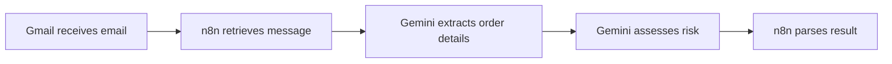

# AI Supplier Guardian

**Supplier email risk assessment · Portfolio edition by Srushti Raj Beerelli**

[Explore my portfolio](https://srushti-analytics-portfolio.thoughtfulturnip.chatgpt.site) · [See the workflow](docs/README.md)

---

## 🚦 Verified risk assessment

> **PO-4421 · Steel Masters Ltd.**  
> A sample supplier email reported a delay and a price increase for 500 steel rods.

| Gemini risk level | Delivery delay | Price increase | Model confidence |
| :---: | :---: | :---: | :---: |
| 🔴 **High** | **30 days** | **7.1%** · $4,200 to $4,500 | **0.90** |

**Recommended action:** Contact the supplier about the changes and evaluate backup suppliers.

## ⚙️ How it works

I configured Supabase and tested the Gmail-to-Gemini workflow. This repository contains the React dashboard and Supabase schema. The automatic write from n8n to the dashboard is pending.

## 🛠️ Run locally

1. Clone `https://github.com/Srushti99-ux/AI-Supplier-Guardian.git` and run `npm ci` in the repository.
2. Copy `.env.example` to `.env`. Set `VITE_SUPABASE_URL` and `VITE_SUPABASE_ANON_KEY` to your project's URL and publishable or legacy anon key.
3. For a fresh Supabase project, run `supabase/schema.sql` once in the SQL Editor.
4. Run `npm run dev`, open the localhost URL shown in the terminal, and sign up or log in.

[Portfolio walkthrough](https://srushti-analytics-portfolio.thoughtfulturnip.chatgpt.site)

## Credits and license

Based on [AI Supply Guardian](https://github.com/abdullahxyz85/AI-Supply-Guardian). The upstream README identifies the project license as MIT.
